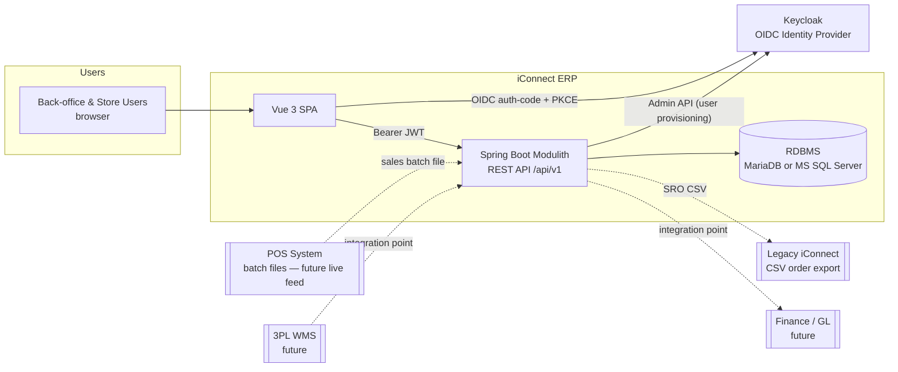

# 01 — System Architecture

## 1. System Context

One deployable backend, one database schema, one SPA. Keycloak is external and required
for every environment (a dev realm export is part of the repo).

## 2. Backend — Spring Boot Modulith

- Java 21, Spring Boot 3.x, **Spring Modulith** for enforced module boundaries.
- Single Gradle/Maven build; single runnable jar; modules are Java packages under one
  application, verified by Modulith structure tests (`ApplicationModules.verify()`).

### 2.1 Modules

| Modulith module | Owns (aggregates) | Spec file |
|---|---|---|
| `shared` | Base entity, auditing, error model, common value types, sequence/number generation | 02, 03 |
| `masterdata` | Company, Branch (+InventoryLocation), PriceZone, CostZone, AssortmentCluster, ReplenishmentProfile, Vendor, VendorCategory, VendorProduct, VendorAllowance, MerchNode, Product (+PackUom, AttrValue), Brand, ProductAttribute | 10 |
| `merchandising` | PriceEvent (+lines), CostEvent (+lines), current price/cost resolution | 11 |
| `planning` | AssortmentPlan (+lines), DemandSignal, DemandOverlay, ReplenishmentPolicy, VendorSchedule, OrderCalendarException, ReplenishmentRun, StoreReplenishmentOrder (+lines) | 12 |
| `procurement` | PurchaseOrder (+lines), DsdDelivery, OtbBudget, MultiStorePO (+allocations), GoodsReceipt (+lines), Asn | 13 |
| `inventory` | StockLedger, StockPosition, MerchandiseIssuance, InventoryAdjustment, StockTransfer, Rtv (+DebitMemo), Conversion (make-up/break-up/cut-up) | 14 |
| `sales` | SalesBatch (+transactions, tender summary, cashier summary), balancing results | 15 |
| `admin` | UserAccount (Keycloak mirror), Role, RolePermission, AccessScope, AuditLog | 16 |

### 2.2 Inter-module rules

1. **No cross-module JPA relationships.** References across module boundaries are by ID
   only (`Long companyId`), validated at the service layer against the owning module's API.
2. **Synchronous access** only through a module's exposed API (public interface in the
   module's root package). Internals (`internal` subpackage) are inaccessible to other modules.
3. **State propagation via application events** (Spring Modulith event publication with
   the event-publication registry for at-least-once delivery). Consumers must be idempotent.
4. A module may cache read-models of other modules' data only by consuming events, never
   by querying another module's tables.

### 2.3 Domain event catalog (minimum set) ⚑ DR-03

| Event | Published by | Consumed by (examples) |
|---|---|---|
| `PriceEventPublished` | merchandising | planning (promo → demand overlay), sales (POS price reference) |
| `CostEventPublished` | merchandising | masterdata (VendorProduct.costPerCase refresh), procurement (open-PO revaluation) |
| `GoodsReceiptPosted` | procurement | inventory (stock in + weighted-average cost recompute), merchandising (margin refresh) |
| `SalesBatchReleased` | sales | inventory (sales stock deduction), planning (demand history) |
| `StockMovementPosted` | inventory | planning (net position refresh) |
| `SroConfirmed` | planning | procurement (optional conversion to POs — future), export job |
| `BranchCreated` | masterdata | inventory (seed inventory locations) |
| `UserProvisioned` | admin | audit |

### 2.4 Layering inside a module

`web` (REST controllers, DTO records) → `application` (services, validation, transactions)
→ `domain` (entities, invariants) → `persistence` (Spring Data repositories).
Generic CRUD is factored into shared abstract base classes (controller + service) so a
simple master needs only: entity, DTOs, repository, service (validation override), controller.

## 3. Security & Identity — Keycloak ⚑ DR-01

### 3.1 Split of responsibility

| Concern | Owner |
|---|---|
| Identity (credentials, password policy, MFA, sessions, tokens) | **Keycloak** |
| Role **membership** of a user (which roles a user has) | **Keycloak** (realm roles, mirrored in JWT) |
| Role **catalog** and role → **permission matrix** | **ERP** (`admin` module) |
| Access **scope** (Company / Region / Store assignment per user) | **ERP** (`admin` module) |
| User administration UI (create user, assign role, assign scope) | **ERP** — the only interface; it provisions into Keycloak via the Admin API |

### 3.2 Flows

- **Login:** SPA → Keycloak, OIDC authorization-code + PKCE. SPA holds access token
  (memory) + refresh token per OIDC best practice.
- **API calls:** `Authorization: Bearer <JWT>`. Backend is a Spring OAuth2 Resource Server;
  validates the token against the realm, maps realm roles from the token.
- **Authorization decision (per request):** JWT roles → ERP permission matrix
  (module × View/Create/Edit/Approve) → allow/deny; then **scope filter** (user's
  Company/Region/Store assignments) restricts the data rows returned or mutated.
- **Provisioning:** ERP "New User" creates the Keycloak user (Admin REST API), assigns
  realm roles, stores the ERP mirror row (`keycloak_subject_id` link), scope assignments,
  and profile fields Keycloak does not hold (employee ID, department, reports-to).
- Deactivating/locking a user disables the Keycloak account and the ERP mirror.

### 3.3 Standard roles

Seeded roles listed in `00-overview.md §6`; `System Administrator` is a protected system
role (cannot be deleted, always full matrix). Permission matrix semantics: `16-administration.md`.

## 4. Database portability — MariaDB ⇄ Microsoft SQL Server ⚑ DR-05

- Access exclusively through JPA/Hibernate with the vendor dialect chosen by configuration;
  no native SQL unless written twice and selected per vendor.
- Schema managed by **Flyway**: common migrations in `db/migration/common` (portable SQL),
  with `db/migration/mariadb` and `db/migration/sqlserver` folders only where syntax
  genuinely diverges.
- Portable type palette and naming rules: `02-data-model.md §2`.
- Forbidden: vendor-specific features (e.g., MariaDB `ON UPDATE CURRENT_TIMESTAMP`,
  SQL Server `IDENTITY` tricks beyond standard identity columns, vendor JSON functions,
  triggers). Timestamps and audit values are set by the application layer.
- CI runs the integration test suite against **both** engines (Testcontainers).

## 5. Frontend

Vue 3 SPA consuming `/api/v1` only — no server-rendered pages. Standards, layout, and
interaction patterns: `04-ui-standards.md`. Session bootstrap: silent OIDC check → load
`/api/v1/me` (profile, effective permissions, scope) → render navigation filtered by the
user's View permissions.

## 6. Batch & Scheduling

- **Auto Replenishment run** — daily at a configured time (default 06:00, Asia/Manila),
  plus on-demand runs. Implemented as a backend job (Spring scheduling + ShedLock-style
  leader election if ever scaled to >1 instance). Spec: `12-planning-replenishment.md §7`.
- **POS batch ingest** — file upload (UI) in Phase 1; automated pickup is a future
  integration point. Spec: `15-sales.md`.
- **Demand baseline recompute** — daily job after sales release; on-demand recompute action.

## 7. Non-Functional Requirements

| Area | Requirement |
|---|---|
| Performance | List/detail API p95 < 500 ms at planning volumes; replenishment run for ~600 stores completes < 30 min; POS batch (≈6k transactions) ingests < 2 min. |
| Availability | Business-hours critical; target 99.5% monthly. Nightly jobs must be re-runnable after failure (idempotent). |
| Auditability | Every create/update/approve/delete on business data writes an AuditLog entry (who, when, what, before/after summary). Audit columns on all tables (`02 §2`). |
| Security | OIDC/JWT everywhere; RBAC + scope enforcement server-side (UI hiding is convenience, not control). Secrets externalized. TLS end-to-end. |
| Data retention | Documents and audit log retained ≥ 5 years (Philippine statutory bookkeeping horizon); archive strategy may move cold data out of the hot schema. |
| Localization | English UI, PHP currency, `Asia/Manila` timezone; dates stored as ISO (DATE/DATETIME, UTC for instants). |
| Observability | Structured logs, metrics (Micrometer), health endpoints; replenishment and ingest jobs emit run logs visible in the UI. |

## 8. Integration points (defined now, built later)

| # | Interface | Direction | Phase-1 stand-in |
|---|---|---|---|
| I-1 | POS sales feed | POS → ERP | Manual batch file upload (`15-sales.md`) |
| I-2 | Store order export | ERP → legacy iConnect | CSV download/export on SRO confirm (`12 §7.6`) |
| I-3 | Finance / GL journal hand-off | ERP → Finance | None; events (`GoodsReceiptPosted`, `SalesBatchReleased`, adjustment postings) are the future feed |
| I-4 | 3PL WMS cross-dock sync | WMS ⇄ ERP | Manual status updates on ASN records (`13-procurement.md §4`) |
| I-5 | Vendor EDI / portal | ERP ⇄ Vendor | None |

Each is an anti-corruption boundary: a dedicated adapter package per integration,
consuming/publishing the domain events above — core modules never call external systems directly.
