# 02 — Data Model

Field-level detail lives in the domain specs (10–16). This document fixes the shared
conventions, the cross-module relationships, and the entity catalog.

## 1. Identity & keys

- Every table has a surrogate PK `id BIGINT`, generated as a standard identity column
  (portable across MariaDB and SQL Server).
- Business identity is a **code** (natural key) with a unique constraint where the domain
  defines one (`company.code`, `branch.code`, `product.code`, `vendor.code`,
  `merch_node.code`, grouping codes, `vendor_allowance.ref`, document numbers).
- Auto-generated codes when left blank (application-side, after insert): ⚑ DR-14
  - Product: `100000 + id`
  - Vendor: `V-{id}`
  - Vendor Allowance: `AL-{id}`
  - Store-grouping codes: user-entered or generated `{PREFIX}-{id}` (PZ/CZ/CL/RP)
  - Documents: per-type sequences — `PC-…` (price event), `CC-…` (cost event), `AP-…`
    (assortment plan), `PO-…`, `DSD-…`, `OTB-…`, `MPO-…`, `GRN-…`, `ASN-…`, `TR-…`,
    `RTV-…`, `DM-…` (debit memo), `ADJ-…`, `MK-…`/`FC-…` (conversions), `SB-…` (sales
    batch), `SRO-{branchCode}-{yyyyMMdd}` (replenishment order). Sequences are allocated
    from a portable `document_sequence` table (SELECT … FOR UPDATE), not vendor sequence
    objects.

## 2. Column conventions (portable) ⚑ DR-05 ⚑ DR-07

| Concern | Rule |
|---|---|
| Naming | `snake_case` tables and columns; singular table names (`branch`, `price_zone`). |
| Strings | `VARCHAR(n)` with explicit lengths (default 255; codes 40; long text 1000–4000). No vendor `TEXT`/`NVARCHAR(MAX)` unless justified per column. |
| Money | `DECIMAL(14,2)` PHP. Percentages `DECIMAL(7,3)`. Quantities `DECIMAL(12,3)` (fresh/weight items sell fractional). |
| Dates | `DATE` for business dates; timestamps `DATETIME`/`DATETIME2` stored in UTC, set by the application. |
| Booleans | `BIT`/`TINYINT(1)` via JPA `boolean`. |
| Enumerations | Stored as `VARCHAR` with the exact UI label set defined per field in the domain specs (e.g., `status`, `format`, `delivery_model`). CHECK constraints optional; validation is authoritative at the application layer. |
| Status / soft delete | Masters are never hard-deleted once referenced; they are set `Inactive` (or domain-specific terminal status). Hard delete is allowed only for unreferenced rows and admin cleanup. ⚑ DR-08 |
| Audit columns | All tables: `created_at`, `created_by`, `updated_at`, `updated_by` (user = Keycloak subject / username), populated by a JPA auditing listener. |
| FKs | Real FK constraints **within** a module; cross-module references are plain indexed `BIGINT` columns validated in the service layer (`01 §2.2`). |

## 3. Core relationships (ERD — masters and groupings)

```mermaid
erDiagram
  COMPANY ||--o{ BRANCH : "companyId"
  COMPANY ||--o{ PRICE_ZONE : "companyId"
  COMPANY ||--o{ COST_ZONE : "companyId"
  COMPANY ||--o{ ASSORTMENT_CLUSTER : "companyId"
  COMPANY ||--o{ REPLENISHMENT_PROFILE : "companyId"
  BRANCH }o--|| PRICE_ZONE : "priceZoneId (nullable)"
  BRANCH }o--|| COST_ZONE : "costZoneId (nullable)"
  BRANCH }o--|| ASSORTMENT_CLUSTER : "assortmentClusterId (nullable)"
  BRANCH }o--|| REPLENISHMENT_PROFILE : "replenishmentProfileId (nullable)"
  BRANCH ||--|{ INVENTORY_LOCATION : "seeded by format"

  VENDOR ||--o{ VENDOR_CATEGORY : "2-level tree"
  VENDOR ||--o{ VENDOR_ALLOWANCE : ""
  VENDOR ||--o{ VENDOR_PRODUCT : ""
  COMPANY ||--o{ VENDOR_PRODUCT : ""
  PRODUCT ||--o{ VENDOR_PRODUCT : "sourcing link"
  VENDOR_CATEGORY |o--o{ VENDOR_PRODUCT : "vendorCategoryId"
  VENDOR_ALLOWANCE |o--o{ VENDOR_PRODUCT : "allowanceId (reference only)"
  COMPANY ||--o{ VENDOR_SCHEDULE : ""
  VENDOR ||--o{ VENDOR_SCHEDULE : "Company · Vendor"
  COMPANY ||--o{ ORDER_CALENDAR_EXCEPTION : ""
  VENDOR |o--o{ ORDER_CALENDAR_EXCEPTION : "blackouts only"

  MERCH_NODE ||--o{ MERCH_NODE : "parentId (4 levels)"
  MERCH_NODE |o--o{ PRODUCT : "merchNodeId (Sub-Class)"
  VENDOR ||--o{ BRAND : "manufacturerId (Manufacturer-type)"
  PRODUCT ||--o{ PRODUCT_PACK_UOM : ""
  PRODUCT ||--o{ PRODUCT_ATTR_VALUE : ""
  PRODUCT_ATTRIBUTE ||..o{ PRODUCT_ATTR_VALUE : "by attribute name"
```

### Membership model for store groupings

A branch's membership in each grouping is a **single nullable FK on `branch`**
(`price_zone_id`, `cost_zone_id`, `assortment_cluster_id`, `replenishment_profile_id`) —
one membership per grouping type per store, branch-side single source of truth. The
grouping editors' dual-list store picker persists by updating the branch rows. ⚑ DR-10

## 4. Transactional relationships (documents)

```mermaid
erDiagram
  PRICE_EVENT ||--|{ PRICE_EVENT_LINE : ""
  COST_EVENT ||--|{ COST_EVENT_LINE : ""
  ASSORTMENT_PLAN ||--|{ ASSORTMENT_PLAN_LINE : ""
  ASSORTMENT_CLUSTER ||--o{ ASSORTMENT_PLAN : "clusterId (or company/store target)"

  REPLENISHMENT_RUN ||--|{ STORE_REPLENISHMENT_ORDER : "one per store"
  STORE_REPLENISHMENT_ORDER ||--|{ SRO_LINE : ""
  DEMAND_SIGNAL }|--|| BRANCH : "store · sku grain"
  DEMAND_OVERLAY }o--o| PRICE_EVENT : "sourced from promo"

  PURCHASE_ORDER ||--|{ PO_LINE : ""
  MULTI_STORE_PO ||--|{ MPO_ALLOCATION : "per store"
  GOODS_RECEIPT ||--|{ GRN_LINE : ""
  GOODS_RECEIPT }o--o| PURCHASE_ORDER : "or DSD ref"
  ASN }o--|| MULTI_STORE_PO : "cross-dock"

  STOCK_LEDGER }|--|| INVENTORY_LOCATION : "all movements"
  INVENTORY_ADJUSTMENT ||--|{ ADJ_LINE : ""
  STOCK_TRANSFER ||--|{ TRANSFER_LINE : ""
  RTV ||--|{ RTV_LINE : ""
  RTV ||--o| DEBIT_MEMO : ""
  CONVERSION ||--|{ CONVERSION_LINE : "inputs/outputs"

  SALES_BATCH ||--|{ SALES_TXN : ""
  SALES_BATCH ||--|{ TENDER_SUMMARY : "MOP"
  SALES_BATCH ||--|{ CASHIER_SUMMARY : ""

  USER_ACCOUNT }o--o{ ROLE : "membership held in Keycloak"
  ROLE ||--|{ ROLE_PERMISSION : "module × V/C/E/A"
  USER_ACCOUNT ||--o{ ACCESS_SCOPE : "Company | Region | Store"
  AUDIT_LOG }o--|| USER_ACCOUNT : ""
```

## 5. Entity catalog

| Entity | Module | Purpose / notes | Spec |
|---|---|---|---|
| company | masterdata | Chain-level legal entity; fiscal/VAT defaults | 10 §1 |
| branch | masterdata | Store; format, region, grouping FKs, address | 10 §2 |
| inventory_location | inventory | Warehouse / Selling Area per store (seeded from format) ⚑ DR-15 | 14 §1 |
| price_zone / cost_zone / assortment_cluster / replenishment_profile | masterdata | Store groupings (shared shape: code, name, companyId, status, description; cluster adds storeProfile, tradeArea) | 10 §3 |
| vendor | masterdata | Supplier master; deliveryModel, terms, rtvAllowed, vendorType | 10 §4 |
| vendor_category | masterdata | Per-vendor 2-level tree | 10 §5 |
| vendor_product | masterdata | Company·Vendor·SKU sourcing terms; cost CCM-owned; single Primary per product | 10 §6 |
| vendor_allowance | masterdata | Trade agreements | 10 §7 |
| vendor_schedule | planning | Company·Vendor weekday order pattern | 12 §5 |
| order_calendar_exception | planning | Holiday / vendor blackout overlay | 12 §6 |
| merch_node | masterdata | 4-level merchandise hierarchy | 10 §8 |
| product (+pack_uom, +attr_value) | masterdata | SKU master | 10 §9 |
| brand | masterdata | Brand owned by Manufacturer-type vendor | 10 §10 |
| product_attribute | masterdata | Attribute definition (value list) | 10 §11 |
| price_event (+line) | merchandising | Dated retail price change document | 11 §2 |
| cost_event (+line) | merchandising | Dated vendor cost change document | 11 §3 |
| assortment_plan (+line) | planning | Full-replacement SKU range per target | 12 §2 |
| demand_signal / demand_overlay | planning | ADD per Store·SKU; promo/seasonal uplift | 12 §3 |
| replenishment_policy | planning | Parameters per Profile × merchandise scope | 12 §4 |
| replenishment_run / store_replenishment_order (+line) | planning | Daily engine output | 12 §7 |
| purchase_order (+line) | procurement | Regular & OTB orders | 13 §2 |
| dsd_delivery | procurement | DSD (no-PO) delivery log | 13 §2.4 |
| otb_budget | procurement | Seasonal OTB budget w/ carry-over | 13 §2.5 |
| multi_store_po (+allocation) | procurement | 1-vendor/N-store consolidated PO | 13 §2.6 |
| goods_receipt (+line) / asn | procurement | Receiving documents | 13 §4 |
| stock_ledger / stock_position | inventory | Movement journal + current position per location·SKU ⚑ DR-16 | 14 §2 |
| merchandise_issuance | inventory | Warehouse → Selling Area movement | 14 §3 |
| inventory_adjustment (+line) | inventory | Count/spoilage/shrink corrections | 14 §4 |
| stock_transfer (+line) | inventory | Store-to-store | 14 §5 |
| rtv (+line) / debit_memo | inventory | Returns to vendor | 14 §6 |
| conversion (+line) | inventory | Make-up / break-up / fresh cut-up | 14 §7 |
| sales_batch (+txn, +tender_summary, +cashier_summary) | sales | POS batch & balancing | 15 |
| user_account / role / role_permission / access_scope | admin | RBAC (identity in Keycloak) | 16 |
| audit_log | admin | Activity trail | 16 §5 |
| document_sequence | shared | Portable number allocation | §1 |

## 6. Derived / read-model values (never stored redundantly without an owner)

- `branchCount` (company), `storeCount` (groupings) — counted from `branch` FKs.
- `marginPct` (product) — `(baseRetail − standardCost) / baseRetail`, computed in the API response.
- `preferredVendor` (product) — name of the vendor on the product's `Primary` vendor_product link.
- `skuCount` (assortment plan) — line count.
- Store **netting position** = on-hand (all locations) + in-transit + on-order − committed; computed from stock_position + open documents (`14 §2`).
- Current retail / current cost per SKU × store = resolution over published events (`11 §4`).
