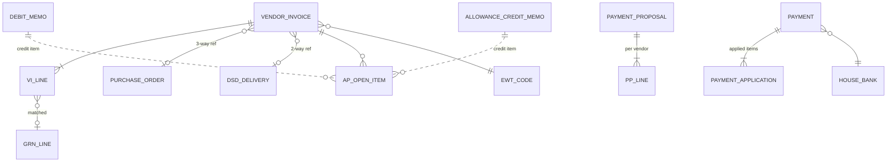

# 17 — Accounts Payable (Vendor Invoices · Payments)

Modulith module: `payables`. **Phase 2** — this module is not part of the Phase 1
baseline (`00 §2`); it is specified now so Phase 1 events and documents are built as its
inputs. It **narrows integration point I-3**: the AP subledger (invoices, matching,
payments, open items, withholding) moves into the ERP; the General Ledger itself stays
external — AP emits mapped journal lines as the I-3 feed. ⚑ DR-26

---

## 1. Scope & positioning

### 1.1 What Phase 1 already provides (consumed, not rebuilt)

| Phase-1 artifact | Role in AP |
|---|---|
| Purchase Order + lines (`13 §2`) | Match basis: ordered qty, unit cost from cost resolution |
| Goods Receipt (GRN) + `GoodsReceiptPosted` (`13 §4`) | Match basis: received qty; receipt cost feeds GR/IR accrual (§5) |
| DSD delivery record incl. vendor invoice no (`13 §2.4`) | 2-way match reference for no-PO deliveries — the "logged for reconciliation" promise is fulfilled here |
| RTV **Debit Memo** `DM-…` (`14 §6`) | Open **credit item** applied against invoices in the payment run; the deferred "payables reversal" posts here ⚑ DR-31 |
| Vendor Allowance, typed rates (`10 §7`, ⚑ DR-12) | Accrual computation basis (§4.2) |
| Vendor `paymentTerms`, `tin` (`10 §4`) | Due-date derivation; BIR withholding & Form 2307 |
| Company `fiscalYearStart` · `defaultVat` · `priceIncludesVat` · `baseCurrency` (`10 §1`) | Fiscal calendar anchor and VAT defaults — extended, not duplicated (§2.3) |
| `stock_ledger` movement costs (`14 §2`) | Valued base for GR/IR accrual and match variance postings |

### 1.2 Out of scope (stays Finance-side)

- **General Ledger / Chart of Accounts** — the ERP maps postings to *external* GL account
  codes (§2.5) and hands journal lines off via I-3; it never owns the CoA. ⚑ DR-26
- **Bank statement reconciliation** — payments carry a `Cleared` status set manually or
  by statement import; full bank reconciliation is Finance-side. ⚑ DR-33
- **Foreign currency** — PHP only, no FX table, per the planning assumptions (`00 §7`);
  a multi-currency vendor is a future breaking change. ⚑ DR-29

## 2. Master data additions

### 2.1 Vendor extension (`10 §4`) ⚑ DR-34

| Field | Rules |
|---|---|
| bankName, bankAccountNo, bankAccountName | remit-to account for bank-transfer payments |
| preferredPaymentMethod | `Check` · `Bank Transfer` |
| ewtCodeId | FK ewt_code (§2.2), nullable — vendor's default BIR ATC classification |
| vatClass | `VATable` · `VAT Exempt` · `Zero-rated` (defaults from company `defaultVat`) |

`tin` (existing) becomes **required for Active vendors once `payables` is enabled** — it
feeds Form 2307.

### 2.2 Tax codes ⚑ DR-28

Philippine model — **not** US 1099. Two small reference masters:

| Entity | Fields | Notes |
|---|---|---|
| `tax_code` | code, name, type `Input VAT` · `Exempt` · `Zero-rated`, ratePct DECIMAL(7,3), status | seeded: `IV12` 12%, `EXM` 0%, `ZR` 0% |
| `ewt_code` | atcCode (e.g. `WC158`), description, ratePct, basis `Goods` · `Services`, status | BIR Alphanumeric Tax Codes; drives EWT deduction + Form 2307 |

### 2.3 Posting periods ⚑ DR-30

Company `fiscalYearStart` exists; what Phase 1 lacks is open/close control:

| Field | Rules |
|---|---|
| companyId | required |
| period | `YYYY-MM` |
| status | `Open` · `Closed` |

Posting an invoice, memo application, or payment into a `Closed` period is rejected
(400, `Posting period 2026-06 is closed`). Only invoice/payment posting checks periods;
Phase-1 documents are unaffected.

### 2.4 House banks

| Field | Rules |
|---|---|
| companyId | required |
| bankName, accountNo, accountName | required |
| paymentMethods | subset of `Check` · `Bank Transfer` |
| status | `Active` · `Inactive` |

### 2.5 Account mapping ⚑ DR-26

Maps posting types to **external** GL account code strings (the CoA lives in Finance):

| Field | Rules |
|---|---|
| companyId | required |
| postingType | `AP Liability` · `GRIR Accrual` · `Input VAT` · `EWT Payable` · `Match Variance` · `Bank` (per house bank) · `Allowance Income` |
| glAccountCode | string(40) — Finance's account code, opaque to the ERP |

Every §8 journal line resolves its account through this table; an unmapped posting type
blocks posting with a clear error.

## 3. Vendor Invoice

The AP document: a vendor's bill registered, matched, approved, posted as an open item.

### 3.1 Header

| Field | Rules |
|---|---|
| viNo | auto `VI-…` — **not** `AP-…`, which is taken by Assortment Plan (`02 §1`) ⚑ DR-27 |
| companyId, vendorId | required; vendor Active |
| vendorInvoiceNo | required; **unique per vendor** (duplicate-invoice guard) |
| invoiceDate, receivedDate | dates |
| dueDate | derived: invoiceDate + vendor `paymentTerms` days; editable with reason |
| matchType | `3-way (PO)` · `2-way (DSD)` · `Non-merchandise` |
| reference | poNo / dsdNo per matchType; none for non-merchandise |
| grossAmount, vatAmount, ewtAmount, netPayable | DECIMAL(14,2); netPayable = gross − ewt (VAT handling per `priceIncludesVat`) |
| taxCodeId, ewtCodeId | default from vendor (§2.1); editable |
| postingPeriod | derived from posting date; must be Open (§2.3) |
| status, version | lifecycle §3.4; optimistic locking ⚑ DR-17 |

### 3.2 Lines

| Field | Rules |
|---|---|
| matched lines | GRN line refs (3-way) or DSD record (2-way): productId, invoicedQty, invoicedUnitCost, matchedQty, matchedUnitCost, qtyVariance, priceVariance |
| non-merchandise lines | description, glAccountCode (from mapping, overridable), amount |

### 3.3 Matching & tolerances

- **3-way** (Regular / OTB / MPO-allocation receipts): invoice vs PO vs posted GRNs.
  Qty matched against *received-not-yet-invoiced*; price against the PO line cost.
- **2-way** (DSD): invoice vs the DSD delivery record's cases/value; the DSD
  `Qty Variance` status surfaces as a match exception.
- **Non-merchandise** (utilities, services, rent): no match — always routes to approval.
- **Tolerances** (per company): price ±% and qty ± threshold; within tolerance →
  auto-`Matched`; outside → `Match Exception` listing each failing line. Variance within
  tolerance posts to `Match Variance` (§2.5).
- Invoicing more than received is never auto-passed, regardless of tolerance.

### 3.4 Lifecycle

```
Draft → Matched | Match Exception → For Approval → Posted → Partially Paid → Paid
                                        (pre-Posted → Cancelled)
```

- `match` runs §3.3; `Matched` invoices within the approver-free threshold may
  auto-submit (config). `Match Exception` always requires explicit resolution
  (re-match after correction, or approver override with reason).
- `approve` requires Approve on Accounts Payable (§10).
- `post` writes the open item (§7), the §8 journal lines, and stamps `postingPeriod`.
- Payment application (§6) drives `Partially Paid` → `Paid`.
- `VendorInvoicePosted` event.

## 4. Credit items

### 4.1 RTV debit memos ⚑ DR-31

Phase-1 `debit_memo` rows (`DM-…`, issued at RTV approval, valued at average cost) are
read as **open credit items** once the RTV reaches `Picked Up`. They reduce the vendor's
payable in the payment proposal (§6.1) and post the payables reversal deferred by
`14 §6`. Application is FIFO against the vendor's open invoices unless manually directed.

### 4.2 Allowance credits ⚑ DR-32

Periodic accrual over Vendor Allowances using the typed `rateValue`/`rateUnit`
(⚑ DR-12): `% of Purchase` and `Per Case` bases accrue from posted GRN values/qtys in
the validity window; `Fixed Amount` accrues on activation. A generated **allowance
credit memo** (`AC-…`) per vendor × allowance × period enters the open-item pool after
approval, settled as a payment-run deduction (default) or carried for offset.

## 5. GR/IR accrual (goods received, not invoiced)

Computed view — no manual document:

- Grain: vendor × PO line; **accrued value** = (received qty − invoiced qty) × receipt
  cost from the GRN posting (`13 §4.1`).
- Exposed as a report (`GET /grir-accruals?asOf=`) and emitted as period-end journal
  lines (`GRIR Accrual` mapping) in the §8 hand-off. ⚑ DR-35

## 6. Payment processing

### 6.1 Payment proposal

| Field | Rules |
|---|---|
| proposalNo | auto `PP-…` |
| companyId, houseBankId, paymentMethod, runDate | required |
| selection | open Posted invoices with dueDate ≤ cutoff; per-vendor netting of debit memos (§4.1) and allowance credits (§4.2); early-payment items flagged |
| lines | per vendor: invoices[], credits[], grossDue, ewtWithheld, **netPay** |

Editable until approval: deselect items, hold a vendor, redirect bank. A vendor whose
credits exceed debits is skipped (carried, never refunded here).

### 6.2 Lifecycle & payment documents

```
Proposal: Draft → For Approval → Approved → Executed        (pre-approved → Cancelled)
Payment:  Issued → Released → Cleared                        (Issued → Voided)
```

On `execute`, one **payment** (`PAY-…`) per vendor: houseBank, method, netPay, applied
items. Check → check no + register; Bank Transfer → PESONet-compatible file export
(adapter, I-3 boundary). `Voided` reopens the applied items. `Cleared` is set manually
or by statement import (§1.2, ⚑ DR-33). `PaymentExecuted` event.

### 6.3 Withholding & remittance ⚑ DR-28

- EWT is deducted per invoice at its `ewt_code` rate; accumulated as `EWT Payable`.
- **BIR Form 2307** (Certificate of Creditable Tax Withheld) generated per vendor ×
  quarter from payment applications — vendor `tin` and ATC codes required.
- Remittance advice per payment: applied invoices, memos, EWT, net.

## 7. Open items & aging

- **ap_open_item** — one row per posted invoice / debit memo / allowance credit /
  payment application: vendor, docRef, sign, amount, openAmount, dueDate. Fully-applied
  items close; the subledger reconciles to the I-3 liability feed by construction.
- **Aging report**: open items bucketed Current · 1–30 · 31–60 · 61–90 · 90+ by
  dueDate; per vendor and total; drill-in to documents.
- **Vendor statement view**: open + recently closed items per vendor for statement
  reconciliation with the supplier.

## 8. Journal hand-off (I-3 realized)

Every AP posting emits balanced journal lines through the account mapping (§2.5), queued
per posting date for Finance:

| Event | Dr | Cr |
|---|---|---|
| Invoice posted (merchandise) | GRIR Accrual (+ Input VAT, + Match Variance) | AP Liability, EWT Payable |
| Invoice posted (non-merch) | line glAccountCode (+ Input VAT) | AP Liability, EWT Payable |
| Debit memo applied | AP Liability | GRIR Accrual / Match Variance |
| Allowance credit applied | AP Liability | Allowance Income |
| Payment executed | AP Liability | Bank (house bank) |

`GET /journal-export?from=&to=` (paged) + file export; each line carries source docRef
for Finance-side drill-back. Retention follows `01 §7` (≥ 5 years).

## 9. Dashboard stats

Open payables value, due in 7 days, match exceptions, unapplied credits (DM + AC),
GR/IR accrual value, EWT payable this quarter — drill into filtered lists.

## 10. Permissions

New permission-matrix rows (`16 §3`): **Accounts Payable** (invoices, memos, credits)
and **Payments** (proposals, execution) × View/Create/Edit/Approve. New standard roles:
**AP Clerk** (capture, match, propose) and **AP Supervisor** (approve invoices and
payment runs) — department `Sales Audit / Finance` (`16 §1`). Payment `execute` requires
Approve on Payments. Scope filtering applies per company.

## 11. Data model additions (for `02`)

New entities, module `payables`: `vendor_invoice (+line)`, `allowance_credit_memo`,
`ap_open_item`, `payment_proposal (+line)`, `payment (+application)`, `tax_code`,
`ewt_code`, `posting_period`, `house_bank`, `account_mapping`, `journal_line`.
Sequences: `VI-…`, `AC-…`, `PP-…`, `PAY-…` (⚑ DR-14; `VI` avoids the `AP-…` collision
⚑ DR-27). Cross-module references (PO, GRN, DSD, debit_memo, vendor) are indexed
`BIGINT` columns validated in the service layer (`02 §2`).



**API:** `/vendor-invoices` (+ `/match`, `/submit`, `/approve`, `/post`, `/cancel`),
`/allowance-credit-memos` (+ `/approve`), `/payment-proposals` (+ `/submit`, `/approve`,
`/execute`, `/cancel`), `/payments` (+ `/release`, `/clear`, `/void`), `/ap-open-items`,
`/ap-aging`, `/grir-accruals`, `/journal-export`, `/tax-codes`, `/ewt-codes`,
`/posting-periods` (+ `/close`, `/reopen`), `/house-banks`, `/account-mappings` —
conventions per `03`.

## 12. Decision-register entries (recorded in `05`)

| # | Decision | Rationale | Where |
|---|---|---|---|
| DR-26 | AP subledger lives in the ERP; GL/CoA stays external — postings map to external account codes and hand off journal lines (I-3 narrowed). | Full AP control without duplicating Finance's ledger. | 17 §1, §2.5, §8 |
| DR-27 | Vendor invoice numbers use `VI-…`; `AP-…` already belongs to Assortment Plan. | Sequence collision in `02 §1`. | 17 §3.1 |
| DR-28 | Philippine tax model: input VAT codes + BIR EWT (ATC) + Form 2307 at payment. No US 1099 concepts. | Deployment is Philippine (`00 §7`, `01 §7`). | 17 §2.2, §6.3 |
| DR-29 | PHP-only AP; no FX/exchange-rate table. | Planning assumption `00 §7`; multi-currency would be a breaking change anyway. | 17 §1.2 |
| DR-30 | Posting-period entity with Open/Closed control for AP postings; company `fiscalYearStart` reused as the calendar anchor. | Company master has fiscal defaults but no period close. | 17 §2.3 |
| DR-31 | RTV debit memos (`DM-…`) become open credit items netted in payment runs — the "payables reversal, future finance hand-off" of `14 §6`. | The document already exists in Phase 1; AP is its consumer. | 17 §4.1 |
| DR-32 | Vendor allowance accrual computed from typed rates (DR-12) into approvable allowance credit memos, settled as payment deductions. | Closes the deferred item in `05` ("accrual computation … future/finance"). | 17 §4.2 |
| DR-33 | AP ends at payment execution + manual/imported `Cleared`; full bank reconciliation stays Finance-side. | Keeps the module inside the merchandising ERP's boundary. | 17 §6.2 |
| DR-34 | Vendor master extended with remit-to bank details, payment method, EWT class; `tin` required for Active vendors when payables is enabled. | AP cannot pay or withhold without them. | 17 §2.1 |
| DR-35 | GR/IR accrual is a computed view over GRN-vs-invoiced quantities at receipt cost — no manual accrual document. | The stock ledger and GRN costing already carry the values. | 17 §5 |
